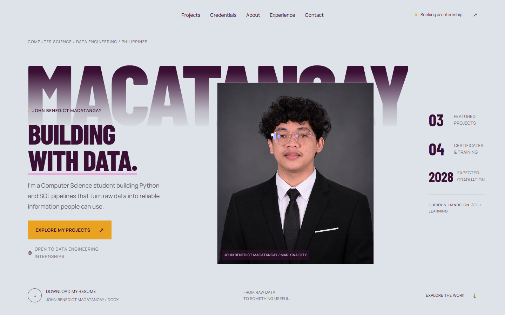
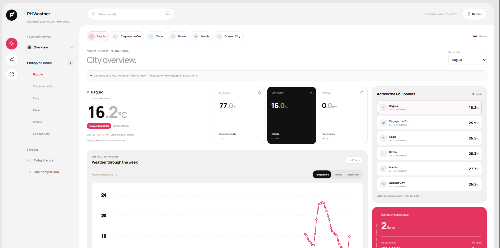
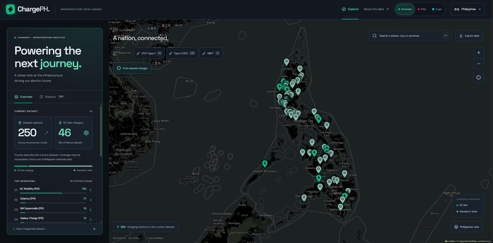
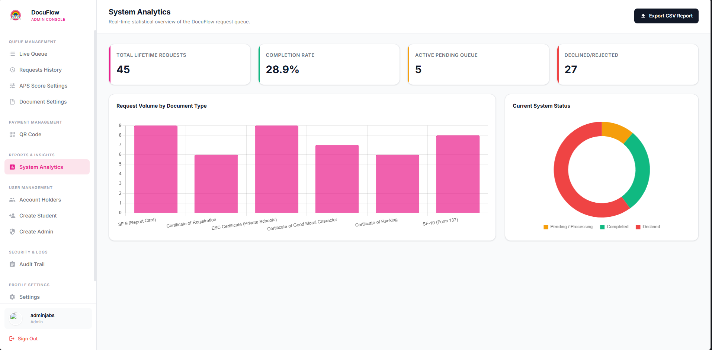
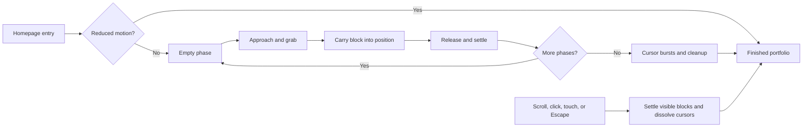

# John Benedict Macatangay

**Computer Science student · Data Engineering & Software Development · Metro Manila, Philippines**

I build Python and SQL workflows that turn raw data into information people can use. I’m studying Computer Science, specializing in Software Engineering, at FEU Institute of Technology, with graduation expected in 2028. I’m looking for a **Data Engineering internship** where I can contribute to data preparation, automation, and software development.

[View portfolio](https://mr-jabs.vercel.app/) · [Download resume](assets/John-Benedict-Macatangay-Resume.docx) · [LinkedIn](https://www.linkedin.com/in/john-benedict-macatangay-7b4515374/) · [Email](mailto:jabsmacatangay6@gmail.com)



## Selected work

This repository contains my portfolio website. The case studies present the following projects, my contributions, and the technologies used.

| Project | What I worked on | Technologies |
| --- | --- | --- |
| **[Philippine Weather Analytics](https://mr-jabs.vercel.app/#work)** | An automated pipeline that collects Philippine weather data, cleans it, and stores it for analysis. A dashboard makes current conditions and weather trends easier to explore. | Python, SQL, PostgreSQL, ETL |
| **[ChargePH](https://mr-jabs.vercel.app/#work)** | An ongoing charging-station map of the Philippines. My Python scripts collect, clean, and standardize station locations for the interactive map. | Python, ETL, geospatial data |
| **[DocuFlow](https://mr-jabs.vercel.app/#work)** | A school document-request system co-built by a team of four for our undergraduate thesis. I designed and built student and admin screens and contributed to the backend. | Flask, MySQL, Docker, Google Cloud |

<p>
  <a href="assets/weatherph.png"></a>
  <a href="assets/chargeph.png"></a>
  <a href="assets/docuflow.png"></a>
</p>

**DocuFlow evaluation:** 62 students, staff, and IT experts gave the system an ease-of-use rating of **4.24/5**. A load test with **50 simultaneous users** recorded approximately **0.12 seconds per response**. These figures describe the thesis system’s evaluation and load test.

ChargePH’s station counts describe its project dataset, rather than a complete national inventory. It remains under development.

## Experience

- **Web Developer — SafeSpace, FEU Institute of Technology · February 2026–present.** Built and launched an anonymous student reporting website, with a calm interface and an admin dashboard using Flask, SQLite, and Chart.js.
- **DataCamp Scholar — Data Engineering Pilipinas · May–September 2026.** Completed four months of hands-on Python, SQL, and data engineering courses through monthly learning missions.
- **Student Researcher — FEU High School · September 2022–June 2023.** Co-developed a campus navigation app informed by student surveys; the project was nominated for presentation at the school Research Fair.

## Certifications and training

All four certificate previews are displayed directly in the website’s Credentials section, with descriptions and links to the original PDFs below.

| Credential | Issuer | Evidence |
| --- | --- | --- |
| SAP Certified — SAP Generative AI Developer | SAP | [Certificate](assets/certificates/John-Benedict-Macatangay-SAP-Generative-AI.pdf) · [Digital badge](https://www.credly.com/badges/3aec3b2e-bb8f-4caa-bd15-b5e9f5337dbe) |
| PMI Project Management Ready® | Project Management Institute | [Certificate](assets/certificates/John-Benedict-Macatangay-PMI.pdf) |
| IT Specialist — Python | Certiport / Pearson VUE | [Certificate](assets/certificates/John-Benedict-Macatangay-Python.pdf) |
| CCNA: Introduction to Networks — course completion | Cisco Networking Academy / FEU Institute of Technology | [Certificate](assets/certificates/John-Benedict-Macatangay-Cisco-Networking.pdf) |

## How this website is built

The portfolio uses **HTML, CSS, and vanilla JavaScript**, with a small Node.js server for local development. Fonts, screenshots, the portrait, resume, and certificates are bundled locally. The deployed website serves static files directly.

The opening animation treats the page as an editor canvas: a small team of decorative cursors picks up blocks and places them into their final positions. Each phase starts empty, then advances to the next view. The cursor changes from an arrow to an open hand, closes around a block during the drag, and releases it at an outlined destination.



### Implementation decisions

- **Keep layout stable.** The original elements retain their space while temporary, non-interactive previews are carried in the overlay. Placing a block does not reflow the whole page.
- **Use one animation clock.** `requestAnimationFrame` coordinates cursor movement, dragging, phase timing, and the final particle bursts.
- **Let readers take over.** Scrolling, touching, clicking, or using the keyboard stops the automatic tour. Unfinished content in view settles in with a short stagger, and the cursors dissolve while native navigation stays available. Direct section links go straight to the content.
- **Make the evidence easy to read.** Main body copy uses 16px or larger text. Certificate previews and descriptions are displayed without an accordion, with full-size PDFs one link away.
- **Respect reduced motion.** The build sequence is skipped when requested by the visitor’s browser or operating system. Content remains readable without JavaScript.
- **Clean up after the animation.** The overlay, temporary previews, animation loop, and intro event listeners are removed after completion or interruption.
- **Keep interactions small.** Project-image tilt is limited to three degrees; text stays level. Technology pills filter the actual project gallery. The reading rail and pipeline progression follow native vertical scrolling.

The cursor team is a visual metaphor, not a live collaboration service. It uses **9 cursors on desktop, 5 on tablet, and 3 on mobile**.

## Run locally

Requires Node.js. There are no npm dependencies to install.

```sh
git clone https://github.com/Mr-Jabs/Mr-Jabs.git
cd Mr-Jabs
npm run dev
```

Open **http://localhost:3000**. The server binds to `127.0.0.1`. Use the `PORT` environment variable to choose another local port.

To check JavaScript syntax:

```sh
npm run check
```

Browser verification covers automatic entry, grab/drag/release states, skip and cleanup behavior, project filters, case-study dialogs, certificate PDFs, keyboard navigation, small-screen layouts, and reduced-motion preferences. The syntax command above is separate from those browser checks.

## Repository guide

```text
index.html          Portfolio content and accessible page structure
styles.css          Layout, typography, palette, and responsive rules
refinements.css     Filters, hover feedback, reading rail, and pipeline
app.js              Case studies, filters, navigation, and scroll interactions
live-canvas.js      Build phases, cursor states, carried previews, and cleanup
live-canvas.css     Cursor graphics, placement frames, and animation styles
server.cjs          Dependency-free local static server
assets/             Original project images, portrait, fonts, resume, certificates
```

For Vercel, use the **Other** preset, an empty Build Command, and `.` as the Output Directory. No environment variables are required. Local reference captures and checking scripts are excluded from Git through `.gitignore`.

## Contact

I’m open to Data Engineering internship opportunities and conversations about the projects above.

**[jabsmacatangay6@gmail.com](mailto:jabsmacatangay6@gmail.com)** · [LinkedIn](https://www.linkedin.com/in/john-benedict-macatangay-7b4515374/) · [Portfolio](https://mr-jabs.vercel.app/)
